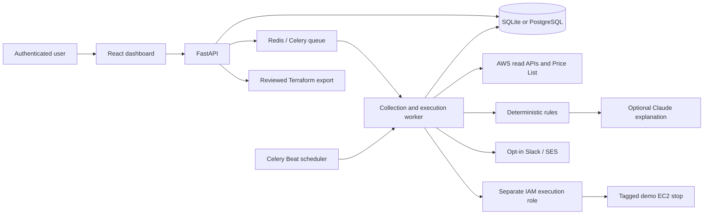

# Cloudwise: Intelligent Cloud Infrastructure Optimizer & Advisor

## Abstract

Cloudwise combines cloud usage collection, deterministic optimization rules and optional
Claude explanations in an approval-controlled dashboard. It identifies idle EC2 resources,
database capacity-review candidates and unusual daily spending. The implementation uses
FastAPI, React, SQLAlchemy, PostgreSQL, Celery, Redis, Boto3 and Terraform. A deterministic
demo works without external services; live AWS integrations require account verification.
Savings are explicitly labelled estimates rather than measured financial outcomes.

## Problem and objectives

Cloud users need to connect utilization evidence to cost decisions without accidentally
disrupting workloads. The project aims to centralize inventory and spending, explain
findings, separate advice from execution, preserve an audit history, and make changes
reviewable. The supported scope is one AWS account and region, EC2 and RDS. GCP and
multi-account organization management are outside the implemented scope.

## Architecture

Local mode uses an in-process background worker and SQLite. Container mode uses
PostgreSQL, Redis, Celery workers and Beat. These are alternative execution modes.

## Method

The collector normalizes resource configuration, tags and metric samples into shared
contracts. Idle EC2 detection checks maximum CPU and network activity over a sustained
window with sufficient samples. Database review combines CPU, freeable memory,
connections and I/O; it does not automatically infer a safe target class. Cost anomaly
detection compares a completed day with fourteen preceding completed days.

Claude receives structured findings and evidence. It explains the finding; deterministic
code selects supported actions, prices and execution eligibility. Invalid/unavailable
model responses fall back to rule explanations. Missing metrics and unavailable prices
remain explicit, rather than being treated as zero.

## Execution and accountability

The user reviews evidence and approves a finding. Execution has a unique idempotency
key and an at-most-one execution constraint per recommendation. Live stops require a
separate role, eligible current evidence, allowed tags and EBS storage. The worker waits
for AWS confirmation; uncertain outcomes require manual review. Terraform provides an
alternative reviewed EC2 workflow. RDS resizing uses a validator for an existing
Terraform-managed database and only permits a scoped, in-place class-change plan.

Passwords use salted scrypt hashes. Sessions expire and can be revoked; password
rotation revokes all sessions. Integrations are configured on the server. Audit records
cover scans, approvals, execution and Terraform exports. The MVP has a single
administrator rather than a multi-user role-based access system.

## Evaluation protocol

1. Run backend tests covering rules, API transitions, idempotency, missing metrics,
   authentication, password rotation, role checks, pricing and Terraform plan validation.
2. Build and type-check the frontend.
3. Run isolated browser tests for the complete demo and password-change flow.
4. Run the isolated Docker verifier for migrations, queue processing and persistence.
5. Validate an actual AWS scan, Claude response, channel delivery and selected demo stop.
6. Verify the hosted HTTPS deployment and database backup/restore.

Only record steps as passed after capturing their actual output. Local code tests do
not prove live service access, deployed uptime or financial savings. Do not present
synthetic demo costs as a reduction in the user's real AWS bill.

## Expected outcomes and limitations

The system produces a browsable inventory, evidence-backed recommendations, estimated
compute savings, reviewed execution and a traceable history. Public On-Demand prices
exclude commitments, discounts, Free Tier, EBS and other ongoing charges. A small or
new account may not contain enough history for live recommendations. No real financial
savings, production uptime or accuracy statistics have yet been measured.

## Team responsibilities

| Area | Responsibility |
|---|---|
| Cloud | Collectors, IAM, Terraform and cloud execution |
| Backend / intelligence | APIs, database, rules, Claude, scheduling and notifications |
| Frontend / delivery | Dashboard, workflows, browser checks, Docker and deployment |

## Presentation outline

1. Cloud waste problem and project objectives.
2. Architecture and team contributions.
3. Inventory and utilization evidence.
4. Findings, risk and transparent pricing assumptions.
5. Claude explanation with rule-based fallback.
6. Approval, simulated execution and Terraform review.
7. Test evidence and live integration results actually observed.
8. Limitations and future work: effective billing rates, GCP, multi-account support,
   richer access roles, workload-aware sizing and automated rollback validation.
